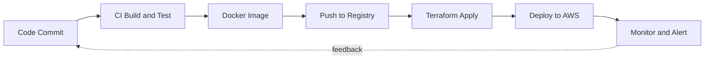

<p align="center">
  
</p>


<p align="center">
  
</p>


<!-- ========== TYPING HEADLINE ========== -->
<p align="center">
  <a href="https://github.com/mrPrijat">
    
  </a>
</p>

<!-- ========== SOCIAL LINKS ========== -->
<p align="center">
  <a href="https://www.linkedin.com/in/[your-linkedin-id]"></a>
  <a href="mailto:princecsdev0321@gmail.com"></a>
  <a href="[your-portfolio-or-blog-url]"></a>
  <a href="https://dev.to/[your-devto-id]"></a>
</p>

<p align="center">
  
  
</p>

---

## 👨‍💻 About Me

```yaml
role:        AWS Cloud & DevOps Engineer
location:    West Bengal, India
focus:       [Infrastructure as Code, CI/CD, Containers, Observability]
certified:   [AWS Certified Solutions Architect – Associate (SAA-C03)]
building:    [current project]
learning:    [current learning goal]
reach_me:    [your-email]
```

> 💡 *"Automate the boring, monitor the critical, and document everything."*

---

## 🛠️ Tech Stack

<p align="center">
  
</p>

<details open>
<summary><b>☁️ AWS Services</b></summary>
<br>

**Compute**


**Networking and Content Delivery**


**Storage and Databases**


**Security and Identity**


**CI/CD and Developer Tools**


**Infrastructure as Code and Management**


**Monitoring and Observability**


**Messaging and Integration**


*(Keep only the services you have actually used.)*

<details open>
<summary><b>☁️ AWS Services</b></summary>
<br>

**Compute**


**Networking and Content Delivery**


**Storage and Databases**


**Security and Identity**


**CI/CD and Developer Tools**


**Infrastructure as Code and Management**


**Monitoring and Observability**


**Messaging and Integration**


*(Keep only the services you have actually used.)*

</details>

<details open>
<summary><b>⚙️ DevOps Tools Around AWS</b></summary>
<br>


*(Keep only the tools you have actually used.)*

</details>
<details>
<summary><b>⚙️ DevOps Toolchain</b></summary>
<br>

| Area | Tools |
|------|-------|
| 🏗️ Infrastructure as Code | Terraform, AWS CloudFormation |
| 🔄 CI/CD | GitHub Actions, Jenkins, AWS CodePipeline |
| 📦 Containers | Docker, Kubernetes, Amazon ECS/EKS |
| 🧰 Configuration Management | Ansible |
| 📊 Monitoring & Logging | CloudWatch, Prometheus, Grafana |
| 💻 Scripting | Bash, Python |
| 🐧 OS | Linux (Ubuntu, Amazon Linux) |

</details>

---

## 🔄 My Delivery Workflow

*(Edit this diagram so it matches how you actually work.)*



---

## 🚀 Featured Projects

| Project | What it does | Stack |
|---------|--------------|-------|
| 🔹 [Project 1](link) | [One-line outcome, e.g., Automated multi-tier VPC deployment] | `Terraform` `AWS` |
| 🔹 [Project 2](link) | [One-line outcome, e.g., CI/CD pipeline deploying containers to ECS] | `GitHub Actions` `Docker` `ECS` |
| 🔹 [Project 3](link) | [One-line outcome, e.g., Centralized monitoring and alerting] | `CloudWatch` `Grafana` |

---

## 📊 GitHub Stats

<p align="center">
  
</p>

<p align="center">
  
</p>

---

## 🌱 Currently Learning

- 🔸 [e.g., Kubernetes (CKA preparation)]
- 🔸 [e.g., Advanced Terraform modules and remote state]
- 🔸 [e.g., AWS security best practices]

---

## 🤝 Let's Connect

<p align="center">
  <i>Open to collaboration on cloud automation and DevOps projects.</i>
</p>

---
